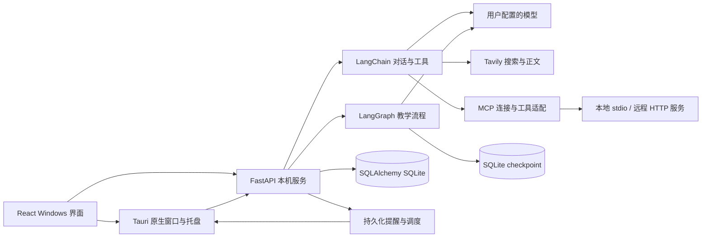

# 架构与数据约定

## 代码分工

- `src/components`：对话、学习、记忆、提醒、设置；`src/lib/api.ts` 统一请求和 SSE，`api.generated.ts` 通过 `pnpm api:types` 从 OpenAPI 生成，仅保留前端使用的 `components` 数据结构；完整接口描述仍导出到 `.local-data/openapi.json`。
- `src-tauri/src/main.rs`：启动本机 Python 子进程、连接认证、单实例、托盘、通知窗口、正常退出时停止自己启动的后端。
- `backend/app/main.py`：受本机 bearer token 保护的领域 API、上传校验、任务入口。
- `agent.py`：LangChain Agent、搜索/正文/记忆/提醒/学习目标工具及审计。
- `tools.py`：内置工具工厂、统一目录及开关，执行前复查与 RunEvent 调用记录；Agent 使用已启用且可用的工具。
- `mcp_service.py`：凭据引用与服务配置、工具发现缓存、按服务隔离的连接任务和串行调用队列，管理连接、取消及资源释放。连接保存不执行，启用或测试才连接；具体约定见 [MCP 接入说明](mcp.md)。
- `learning.py`：课程规划，`teach → await_submission → assess` 教学图。
- `runs.py`：任务生命周期、超时、取消、数据库事件。
- `reminders.py`：从数据库取到期事项，写入唯一通知，并推进重复任务时间。
- `db.py` 和 `migrations`：领域模型与不可变版本迁移。
- `desktop_backend.py` 与 `bai-backend.spec`：安装版的独立 Python 后端入口与运行时封装，包含迁移源文件；开发时继续直接运行 Python 环境。
- `tauri.release.conf.json`：把封装后端作为资源安装。release 使用资源目录启动后端并将数据放在用户本地应用目录；不引用编译时的源码路径。`BAI_DATA_DIR` 和 `BAI_BACKEND_PORT` 可用于隔离验证。退出时只停止本次桌面进程启动的后端。

## 关键约定

每个学习目标有一版有序课程。前置知识只能引用已经排在前面的点；生成结果完整校验后一次提交，已有课程不覆盖。`passed` 表示练习反馈通过，`skipped` 表示跳过且尚未验证，两者在显示与统计上分开。

每次教学创建唯一 lesson 和 graph thread。LangGraph 在等待练习时保存 checkpoint；提交使用稳定的 submission_id 去重。评估失败时保留等待状态和 graph checkpoint，重试后保存一次反馈。服务重启将中断的模型任务标记为失败，用户显式重试；已经保存的课程与练习继续保留。该机制依据 [LangGraph persistence](https://docs.langchain.com/oss/python/langgraph/persistence) 和 [interrupts](https://docs.langchain.com/oss/python/langgraph/interrupts)。

SSE 的事件先存数据库再读取，界面断开不取消任务。重新打开界面可以重放事件和读取最终状态。模型工具操作即时生效，取消生成不会撤销已完成的记忆或提醒操作；界面会说明并可在对应页管理。

记忆默认自动整理明确、稳定的普通偏好；私密信息和推测内容进入待确认。用户可切换“每次确认”，明确要求记住的内容已有授权，直接保存。只有 confirmed 记忆进入背景检索；candidate 等待确认。对话保留近期上下文，删除记忆与删除历史对话是独立操作。来源、版本保护、撤销与迁移见 [记忆保存与确认](memory.md)。当前为单人本机版本，profile_id 为 local；未来云端必须将身份校验和用户过滤落实到全部查询。

提醒时刻统一存带时区的 UTC ISO 文本，重复规则按指定时区的本地时间推进。通知以 reminder_id + occurrence_at 唯一，修改或取消提醒时作废未读旧通知。界面固定北京时间，API 支持 IANA 时区。Windows 原生通知可能受系统通知设置影响，独立提醒窗口作为可见入口。

图片最多 4 张、单张 10 MB，解码后限制像素，去 EXIF、缩放并转 JPEG，以 UUID 保存。图片请求必须经过本机认证，模型图片输入需显式启用。代码提交仅作为文本反馈，未实现执行沙箱。

模型、搜索、图执行与业务数据分离；后续手机使用相同 REST/SSE 合同，不共享 Tauri 的 IPC。当前没有云端运行环境或跨设备账号。
