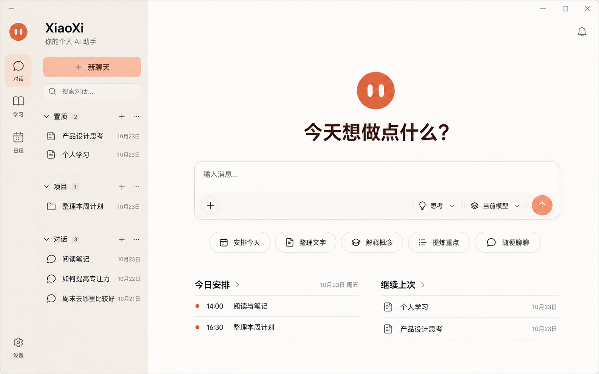
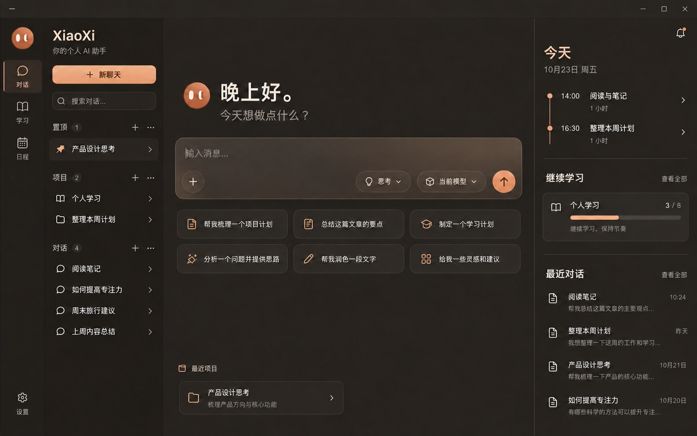
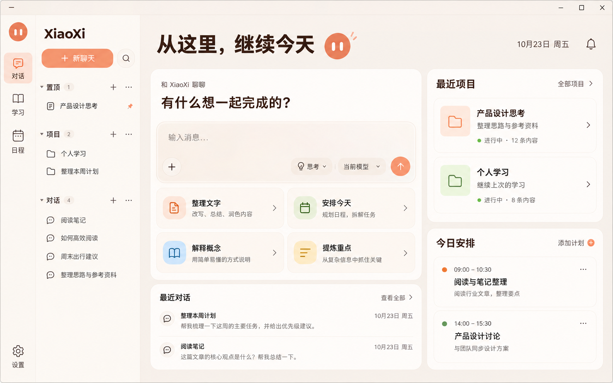
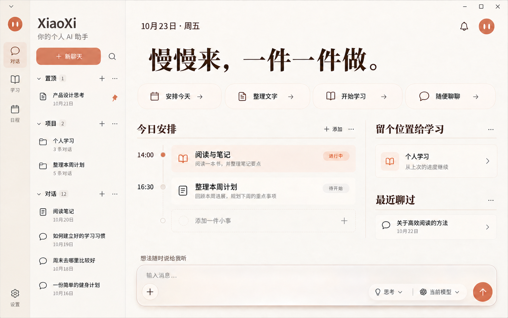
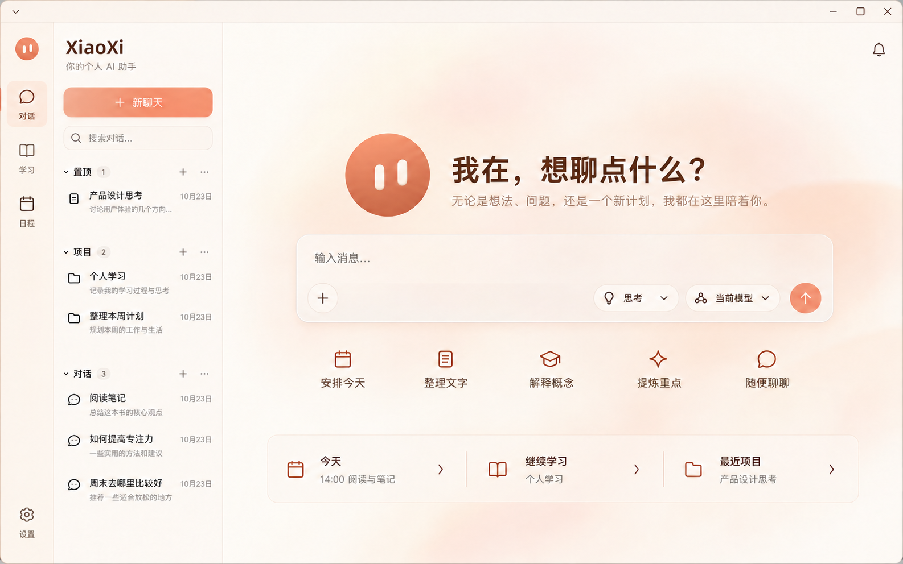

# XiaoXi 主页设计方案 · 2026-10-23

本轮使用内置 image_gen 生图工具制作 5 张独立的高保真桌面主页效果图，供用户比较布局和视觉方向。尚未选择实施方案，未修改应用主页。图中的对话、项目、计划和进度均为设计示例，不读取个人数据。

| 编号 | 方案 | 布局重点 |
| --- | --- | --- |
| 01 | [奶油留白](01-cream-space.png) | 居中问候与输入框，下方轻量日程与上次任务 |
| 02 | [深色专注](02-warm-dark-focus.png) | 暖深色聊天区，右侧独立日程、学习与接续栏 |
| 03 | [双栏工作台](03-split-workbench.png) | 左侧聊天和快捷行动，右侧项目与今日安排 |
| 04 | [晨间手帐](04-morning-journal.png) | 日期与日程主导，底部磨砂输入框 |
| 05 | [轻盈陪伴](05-light-companion.png) | 横向头像问候、开放式快捷入口与接续栏 |

共用特征：保留奶油杏／暖深色品牌语言、双眼圆形头像、图标导航与聊天侧栏、紧凑磨砂玻璃输入框，以及整合附件／MCP／技能的加号入口。各图是生图提案，局部文字、图标、头像渲染及控件密度不作为最终实现规格。

生成提示词和品牌文字修正提示词完整保存在 [prompts.md](prompts.md)。未运行应用测试、未打开桌面测试版、未构建安装包；待用户比较方案、确认需要保留或组合的设计。

## 01 · 奶油留白

## 02 · 深色专注

## 03 · 双栏工作台

## 04 · 晨间手帐

## 05 · 轻盈陪伴

